<p align="center">
  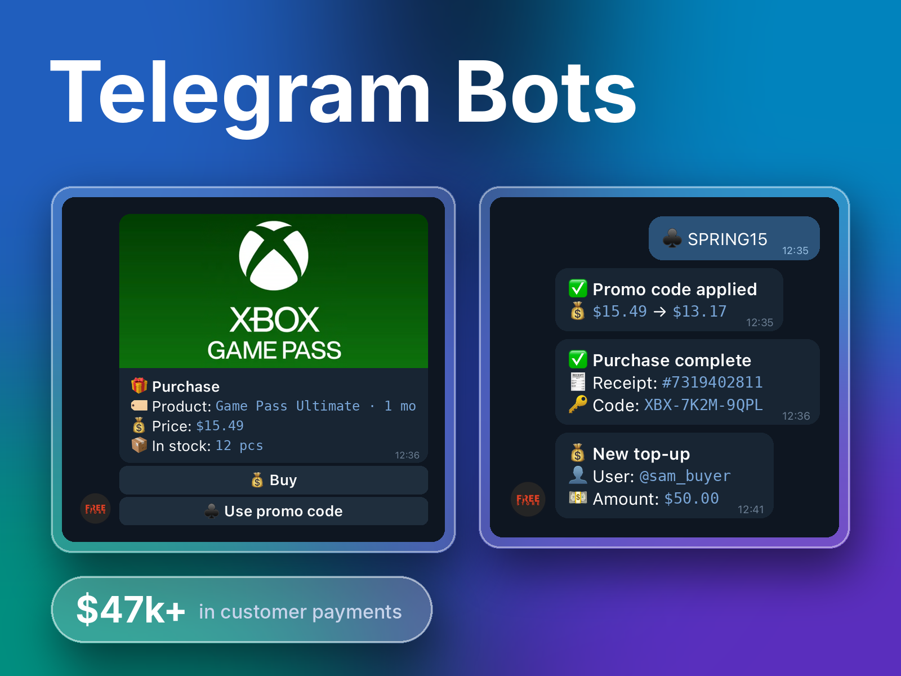
</p>

<h1 align="center">Telegram Shop Bot</h1>

<p align="center">
  <b>An online store for digital goods that lives entirely inside Telegram.</b><br>
  Customers browse, pay and get their code in the chat. The owner runs the store from the same chat.
</p>

<p align="center">
  
  
  
  
  
</p>

<p align="center">
  <a href="#walkthrough">Walkthrough</a> ·
  <a href="#management">Management</a> ·
  <a href="#results">Results</a> ·
  <a href="#engineering">Engineering</a> ·
  <a href="#run-locally">Run locally</a> ·
  <a href="#for-business">For business</a>
</p>

---

## 💡 The problem

Selling gift cards, game subscriptions and activation codes through DMs doesn't scale. Someone has to answer "is it in stock?", confirm every payment, find a code, send it, and keep track of who bought what. Customers wait, sales get lost at night, and the owner never knows the real numbers.

## ✅ The solution

A shop bot that does the whole sale on its own: catalog with live stock, wallet top-ups through payment providers, one-tap purchases and instant delivery of the code right in the chat. The owner manages products, stock, promo codes and settings from Telegram, without a separate admin panel or a computer.

This is a **production bot, not a tutorial project**. It ran a real store with real customers and payments, and later grew into the [FreeStore web platform](https://github.com/fpoweredd/demo-freestore).

<a id="walkthrough"></a>

## 📸 Walkthrough

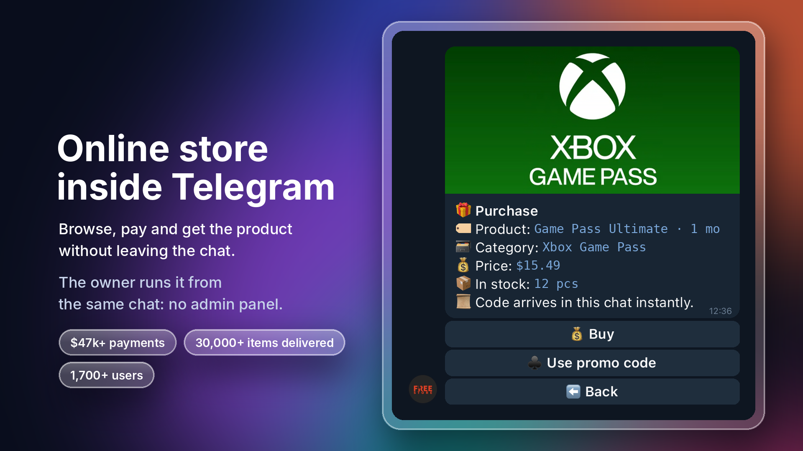

**Online store inside Telegram.** Browse, pay and get the product without leaving the chat. Every product card shows the price and how many items are in stock.

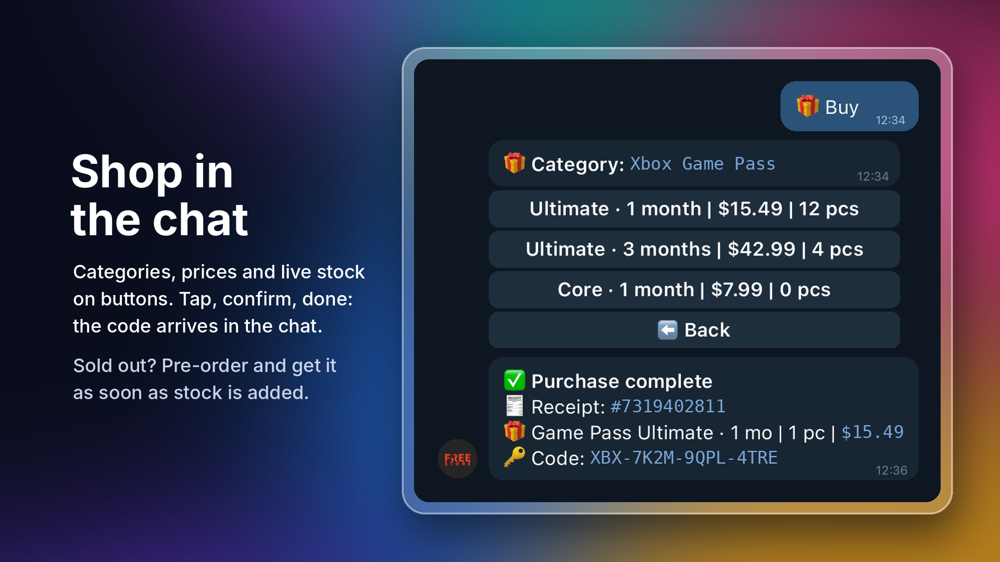

**Shop in the chat.** Categories, products, prices and live stock on buttons. Tap, confirm, done: the code arrives with a receipt. Sold out? The customer can leave a pre-order.

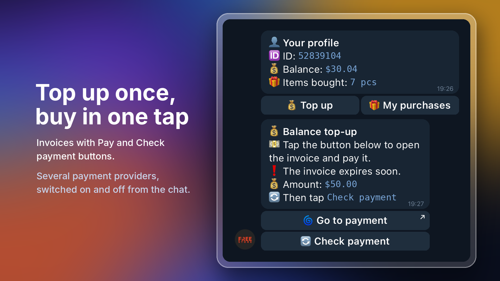

**Top up once, buy in one tap.** The bot issues an invoice with *Pay* and *Check payment* buttons and credits the balance once the payment is confirmed. The profile shows the balance and purchase history.

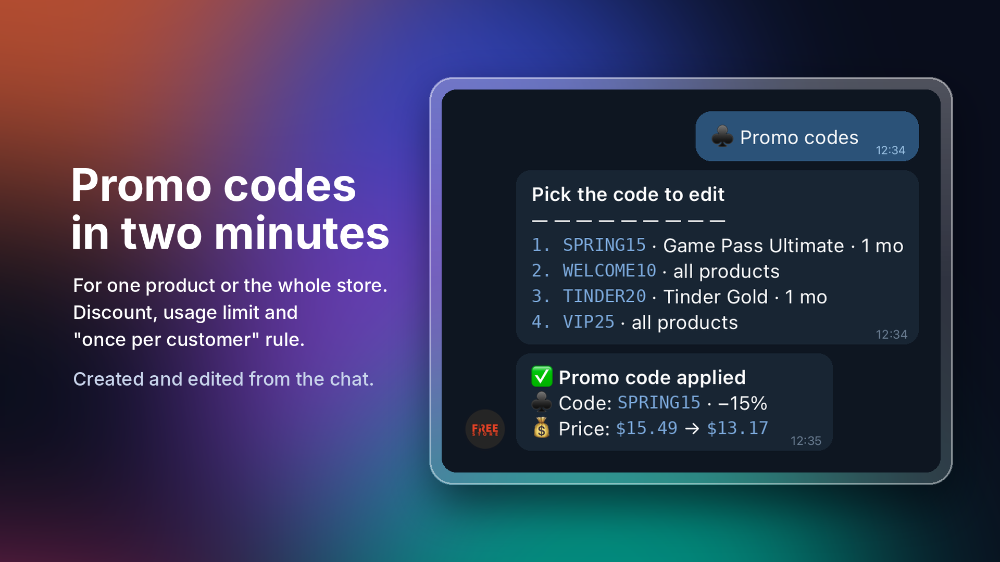

**Promo codes in two minutes.** For one product or the whole store, with a discount, a usage limit and a "once per customer" rule. Created and edited from the chat.

<a id="management"></a>

## 📲 Running the store from the chat

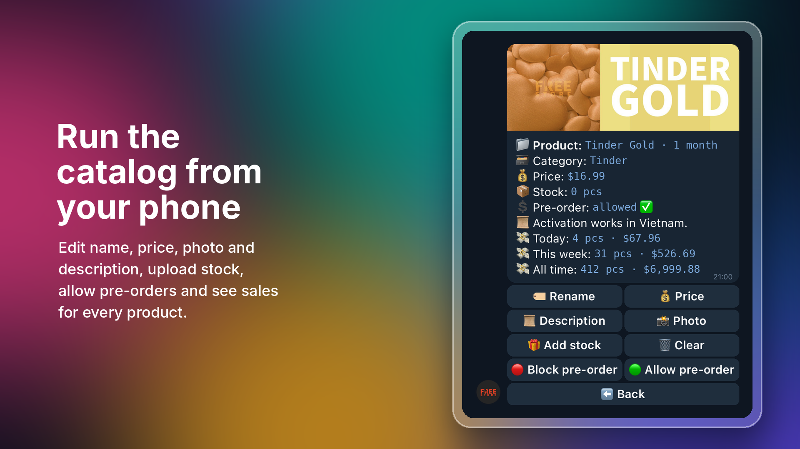

**Run the catalog from your phone.** Edit the name, price, photo and description, upload stock, allow pre-orders and see sales for every product.

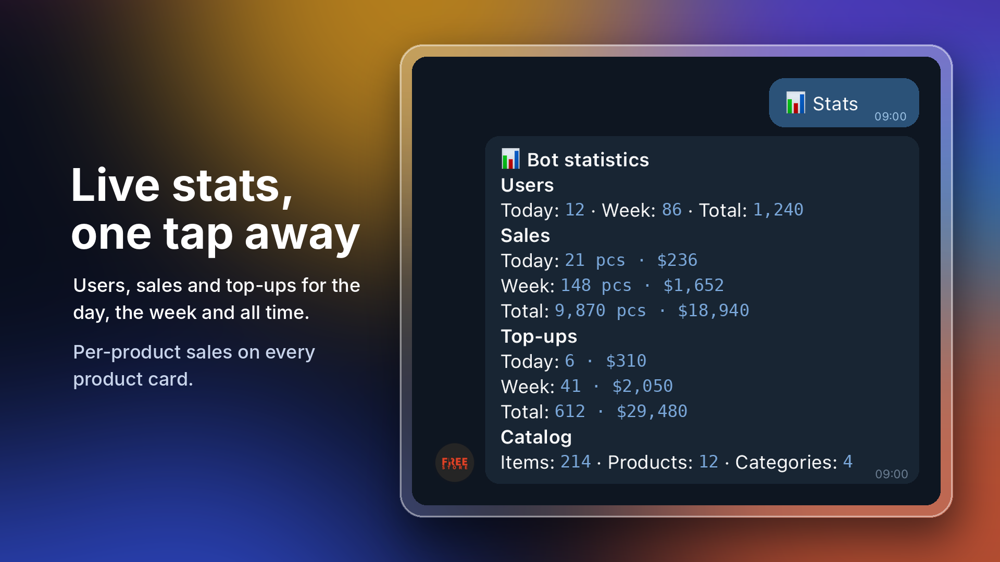

**The numbers, any time.** Users, sales and top-ups for today, this week and all time, plus stock and catalog totals.

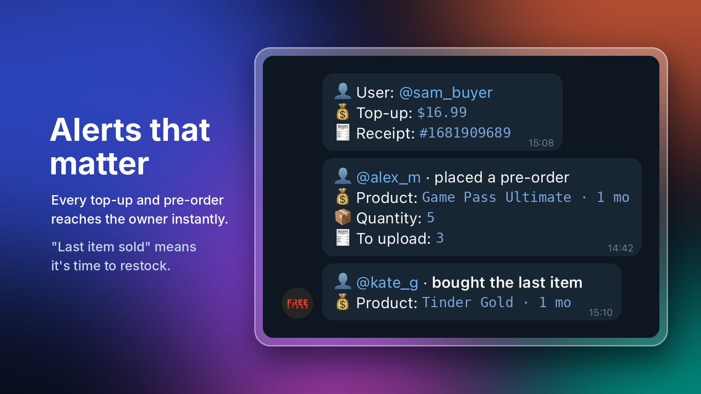

**Nothing slips by.** Admins get a message on every top-up, every pre-order and when someone buys the last item in stock.

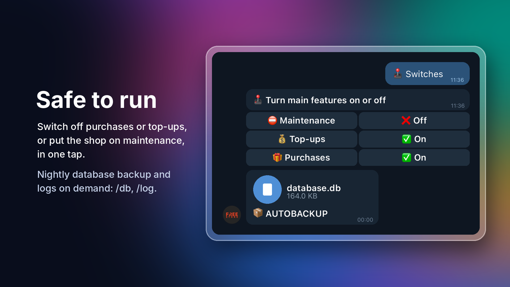

**Safe to run.** Maintenance mode, purchases and top-ups are switched on and off with one tap. The database is backed up to the admins every night.

> Messages on the slides are shown in English with example data. IDs, handles and the statistics on the stats slide are fictional.

<a id="results"></a>

## 📈 Results

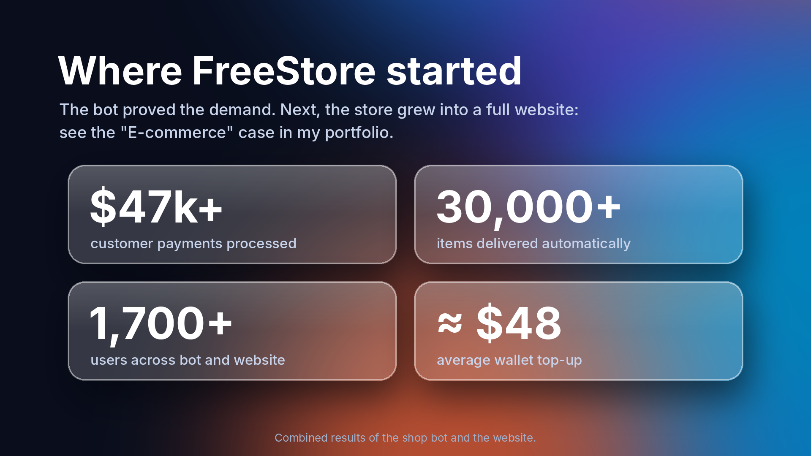

| | |
|---|---|
| **$47k+** | customer payments processed |
| **30,000+** | items delivered automatically |
| **1,700+** | users |

Combined results of the shop bot and the [FreeStore website](https://github.com/fpoweredd/demo-freestore).

## ✨ What it does

### For customers
- **Catalog on buttons.** Categories → products → purchase, with prices and live stock, paginated for large catalogs.
- **Instant delivery.** Codes or files are sent in the chat right after the purchase, with a receipt.
- **Wallet.** Top up once through a payment provider, then buy in one tap from the balance.
- **Promo codes.** Discounts for a single product or the whole store.
- **Pre-orders** for products that are out of stock.
- **Profile** with balance, purchase history and receipts. Support and FAQ sections.

### For the owner
- **Catalog management:** categories, products, photos, descriptions, bulk stock upload, per-product sales stats.
- **Promo codes:** discount, usage limit, one use per customer, one product or all products.
- **Pre-orders:** list of pending pre-orders and a notification for each new one.
- **Customer search:** find a user or a receipt, view their purchases, change the balance, message them.
- **Broadcasts** to all users of the bot, for new products and promotions.
- **Switches** for maintenance mode, purchases and top-ups, and on/off for each payment provider.
- **Statistics** for the day, the week and all time.
- **Admin alerts:** top-ups, pre-orders, last item sold.
- **Nightly database backup** sent to the admins, plus `/db` and `/log` commands to download the database and logs on demand.

## ⚙️ How a purchase works

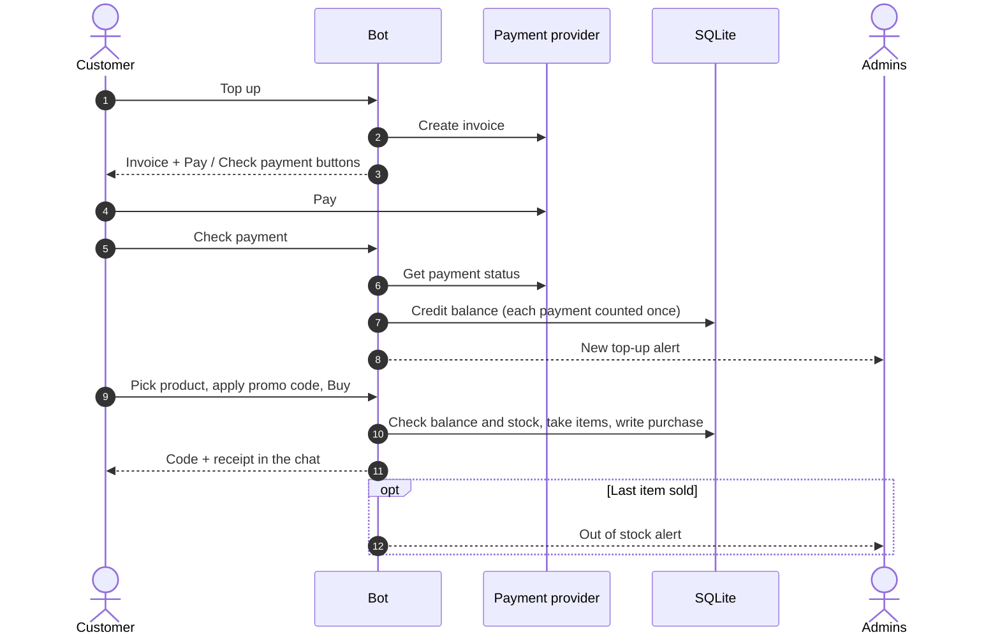

<a id="engineering"></a>

## 🛠️ Engineering highlights

- **FSM-driven flows.** Every multi-step action (top-up amount, purchase quantity, promo code, product editing) is a finite-state machine, so the bot always knows what the user is answering.
- **Role-based access.** Admin handlers are protected by filters; admins are set in the environment, not in the code.
- **Anti-flood middleware** throttles users who spam buttons or commands.
- **Payments counted once.** Each payment is stored with its provider ID, so pressing *Check payment* twice never credits the balance twice.
- **Scheduled jobs** with APScheduler: daily and weekly stats reset at midnight and a nightly database backup.
- **Configuration through `.env`**, with no secrets in the code or in the repository.
- **Docker-ready.** Non-root container, data in a volume, one command to start.

### Services and data

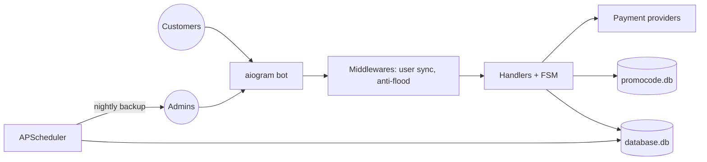

### Tech stack

- **Bot:** Python 3.11, aiogram 2 (FSM, inline and reply keyboards, middlewares, filters)
- **Database:** SQLite (store data, promo codes in a separate database)
- **Scheduler:** APScheduler
- **Payments:** invoice-based providers behind a common flow: create invoice → check status → credit balance
- **Infrastructure:** Docker, Docker Compose, python-dotenv

<a id="run-locally"></a>

## 🚀 Run locally

Requires Docker and a bot token from [@BotFather](https://t.me/BotFather).

```bash
cp .env.example .env      # set BOT_TOKEN and ADMIN_IDS
docker compose up -d --build
```

Open your bot in Telegram and send `/start`. Admins see the admin menu.

| Variable | Required | What it does |
|---|---|---|
| `BOT_TOKEN` | yes | Token from @BotFather |
| `ADMIN_IDS` | yes | Telegram IDs of admins, comma-separated |
| `BOT_DESCRIPTION` | no | Text shown in the bot description |
| `TZ` | no | Time zone for scheduled jobs and receipts |
| `DATA_DIR` | no | Where databases, logs and texts are stored (`/data` in Docker) |

Without Docker:

```bash
python -m venv .venv && source .venv/bin/activate
pip install -r requirements.txt
cp .env.example .env
python main.py
```

### Project structure

```
main.py                 # entry point: bot, middlewares, scheduler
tgbot/
├── data/               # config (.env), loader, default texts
├── handlers/           # user menu, purchases, top-ups, admin sections
├── keyboards/          # inline and reply keyboards, pagination
├── middlewares/        # user sync, anti-flood
├── modules/            # promo code creation
├── services/           # SQLite access, payment provider clients
└── utils/              # helpers, filters, logging, bot commands
```

<a id="for-business"></a>

## 💼 For business

The same approach fits any business that sells or serves customers in Telegram:

| Use case | What changes |
|---|---|
| **Digital products** (codes, licenses, courses, files) | Payment and delivery happen automatically, 24/7, with no one sending codes by hand. |
| **Bookings and services** | Customers pick a service and a time in the chat, and the team gets notified instantly. |
| **Support and FAQ** | Common questions are answered by the bot, and the rest reach the team with full context. |
| **Communities and channels** | Paid access, subscriptions and broadcasts to every subscriber. |

**Selling or serving customers through Telegram DMs?** I build Telegram bots that take payments, deliver products, handle bookings and keep your team informed automatically. See [my GitHub profile](https://github.com/fpoweredd) for more!
